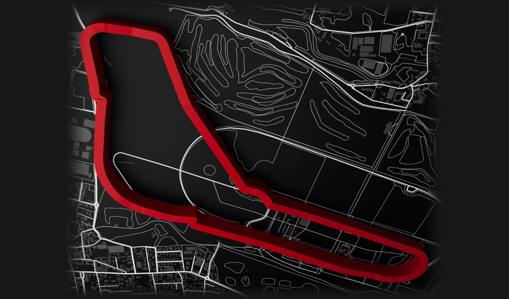
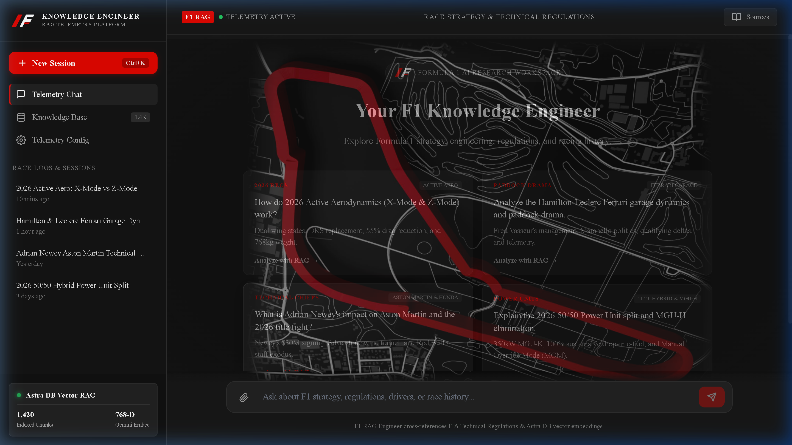
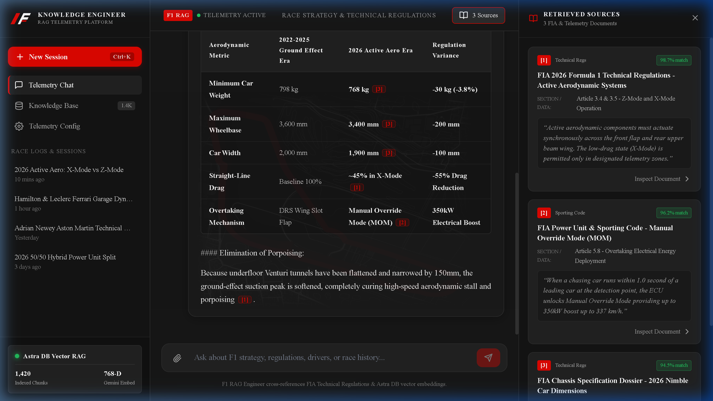
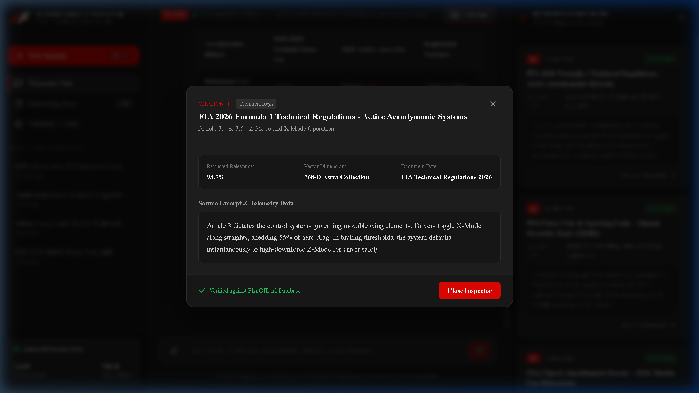
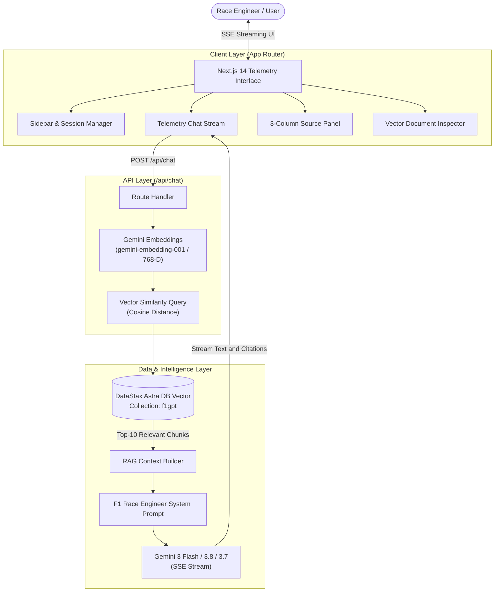

# 🏎️ F1 Knowledge Engineer | Telemetry & RAG Platform

<p align="center">
  
</p>

<p align="center">
  <strong>An AI-powered Formula 1 race engineering, telemetry analytics, and regulatory research platform.</strong><br>
  Built with Next.js 14, DataStax Astra DB Vector, Google Gemini 2.0 / 3.0, and 768-dimensional neural embeddings.
</p>

<p align="center">
  <a href="https://nextjs.org"></a>
  <a href="https://www.typescriptlang.org"></a>
  <a href="https://astra.datastax.com"></a>
  <a href="https://ai.google.dev"></a>
  <a href="https://github.com/suhasbp37/nextjs-f1-gpt/blob/main/LICENSE"></a>
</p>

---

## 📸 Interface Preview

### 1. Telemetry Research Dashboard (Horizontal Monza Circuit)
> The welcome terminal features a 3D Autodromo Nazionale Monza circuit map seamlessly feathered into deep charcoal surfaces, telemetry chips, and categorized prompt suggestions.



---

### 2. Live Telemetry Chat & 3-Column Sources Drawer
> Real-time streaming responses with structured aerodynamic comparison tables, inline citation tags (`[1]`, `[2]`), and a live retrieved sources inspector.



---

### 3. Deep Document & Vector Inspector Modal
> Click any inline citation or source card to inspect the raw document chunk, vector similarity match percentage, 768-D Astra collection provenance, and FIA verification status.



---

## ⚡ Key Capabilities

### 🏁 2026 Formula 1 Era Intelligence
- **Active Aerodynamics (X-Mode & Z-Mode)**: Full technical breakdowns of the FIA's replacement for conventional DRS. Details cornering stability in high-downforce **Z-Mode** and straight-line flap actuation in low-drag **X-Mode** (55% drag reduction).
- **50/50 Hybrid Power Unit Split**: Complete coverage of the abolition of the complex MGU-H, the tripling of electrical energy recovery via the 350kW MGU-K, and 100% advanced sustainable drop-in biofuel.
- **Manual Override Mode (MOM)**: Strategy parameters for deployment of 350kW electrical overtake boost up to 337 km/h when running within 1.0s of a leading car.
- **Nimble Car Chassis Concept**: 768kg minimum weight (-30kg reduction), contracted 1,900mm width, shortened 3,400mm wheelbase, and flattened underfloor Venturi tunnels to cure porpoising.

### 🎭 Paddock Drama & Garage Politics
- **Hamilton-Leclerc Ferrari Garage Dynamics**: The dynamics inside Maranello under Team Principal Fred Vasseur as Lewis Hamilton joins Scuderia Ferrari to partner Charles Leclerc.
- **Adrian Newey at Aston Martin**: Insights into Lawrence Stroll's $30M+/year technical partnership, Aston Martin's new Silverstone wind tunnel, and exclusive Honda works engine collaboration.
- **Red Bull Technical Exodus**: Management tensions, Jonathan Wheatley's exit to Audi, and Red Bull Powertrains / Ford 2026 in-house engine challenges.
- **Audi F1 Team Takeover**: Mattia Binotto (COO/CTO) and Jonathan Wheatley leading the Sauber acquisition with Nico Hülkenberg and Gabriel Bortoleto.
- **Alpine Mercedes Transition**: The Viry-Châtillon engine closure and Alpine's move to Mercedes customer power units and gearboxes.

### 🧠 Hybrid Vector RAG Pipeline
- **Vector Database**: Connects to **DataStax Astra DB Vector** using `@datastax/astra-db-ts`.
- **High-Density Neural Embeddings**: Generates 768-dimensional vector representations with Google's `gemini-embedding-001` matching collection dimensions.
- **Intelligent Knowledge Fallback**: If Astra DB is offline, empty, or unconfigured, the system automatically falls back to an internal authoritative knowledge base.
- **Multi-Model Fallback Engine**: Streams answers through `gemini-3-flash-preview` with automatic fallback to `gemini-3.8-flash` and `gemini-3.7-flash`.

### 🎨 Motorsport Engineering Design System
- **Formula 1 Color Palette**: Restrained `#E10600` Racing Red, `#171717` Deep Charcoal, `#222222` elevated surfaces, and telemetry green status indicators.
- **Monza Circuit Blueprint**: Custom widescreen 3D Autodromo Nazionale Monza track map that automatically dims to `0.04` opacity during active conversations.
- **Technical Typography**: Google Fonts **Inter** for crisp narrative text paired with **IBM Plex Mono** for telemetry delta numbers.

---

## 🏗️ System Architecture



---

## 🛠️ Tech Stack

| Component | Technology | Purpose |
| :--- | :--- | :--- |
| **Framework** | [Next.js 14 (App Router)](https://nextjs.org) | Server Components, Streaming Route Handlers, Edge optimization |
| **Language** | [TypeScript 5](https://www.typescriptlang.org) | End-to-end type safety across telemetry payloads and DB models |
| **Vector Database** | [DataStax Astra DB](https://astra.datastax.com) | Serverless Vector DB storing chunked FIA regulations & telemetry data |
| **LLM & Embeddings** | [Google Gemini AI Studio](https://ai.google.dev) | `gemini-embedding-001` (768-D) and `gemini-3-flash-preview` |
| **Document Loaders**| [LangChain Community](https://js.langchain.com) | Puppeteer web scraping and regulatory document extraction |
| **Styling** | Vanilla CSS Design System | Custom motorsport engineering aesthetic, zero bloat, high FPS |
| **Typography** | Inter + IBM Plex Mono | Telemetry readability and monospace tabular alignment |

---

## 🚦 Getting Started

### 1. Prerequisites
- **Node.js**: `v18.17.0` or higher
- **npm**, **yarn**, or **pnpm**
- **DataStax Astra DB** account (free tier available)
- **Google AI Studio API Key** (for Gemini chat and embeddings)

### 2. Clone the Repository
```bash
git clone https://github.com/suhasbp37/nextjs-f1-gpt.git
cd nextjs-f1-gpt
```

### 3. Install Dependencies
```bash
npm install
```

### 4. Configure Environment Variables
Copy `.env.example` to create your local `.env` file:
```bash
cp .env.example .env
```
Fill in your credentials:
```env
# DataStax Astra DB Credentials
ASTRA_DB_NAMESPACE="default_keyspace"
ASTRA_DB_COLLECTION="f1gpt"
ASTRA_DB_API_ENDPOINT="https://<your-db-id>-<region>.apps.astra.datastax.com"
ASTRA_DB_APPLICATION_TOKEN="AstraCS:<your-token>"

# Google AI Studio Gemini API Key
GOOGLE_API_KEY="AIzaSy..."
```

### 5. Ingest F1 Knowledge into Astra DB (Optional)
To scrape and embed the latest 2026 regulations and dossiers into your Astra DB vector collection:
```bash
npm run seed
```

### 6. Run the Development Server
```bash
npm run dev
```
Open [http://localhost:3000](http://localhost:3000) (or `http://localhost:3001` if port 3000 is occupied) in your browser.

### 7. Build for Production
```bash
npm run build
npm run start
```

---

## 📂 Project Structure

```
nextjs-f1-gpt/
├── app/
│   ├── api/
│   │   └── chat/
│   │       └── route.ts              # Gemini streaming + Astra DB Vector RAG route
│   ├── components/
│   │   ├── Bubble.tsx                # Chat message bubble with markdown formatting
│   │   ├── CircuitBlueprint.tsx      # Horizontal Monza 3D background with dynamic dimming
│   │   ├── F1Icons.tsx               # Motorsport iconography (telemetry, flags, engine)
│   │   ├── LoadingBubble.tsx         # Telemetry calculation spinner
│   │   ├── MarkdownContent.tsx       # Markdown parser for tables, lists, and inline citations
│   │   ├── PromptSuggestionsRow.tsx  # Categorized 2026 suggestion prompt cards
│   │   ├── Sidebar.tsx               # Navigation, race session history, and Astra DB status
│   │   ├── SourcePanel.tsx           # 3-column retrieved document drawer & inspection modal
│   │   └── sampleData.ts             # Built-in 2026 regulation & paddock dossiers
│   ├── globals.css                   # F1 engineering design tokens, layout & animations
│   ├── layout.tsx                    # Root layout with Inter and IBM Plex Mono fonts
│   └── page.tsx                      # Main telemetry workspace & chat state coordinator
├── docs/
│   └── screenshots/                  # High-resolution application screenshots
│       ├── welcome-screen.png
│       ├── active-conversation.png
│       ├── sources-inspector.png
│       └── document-inspector.png
├── public/
│   ├── monza-track-horizontal.png    # Feathered widescreen 3D Monza circuit map
│   └── monza-track.png               # Original top-down track asset
├── scripts/
│   └── loadDb.ts                     # Puppeteer scraper & Astra DB vector loader
├── .env.example                      # Safe environment variable configuration template
├── .gitignore                        # Git ignore excluding private secrets and builds
├── package.json
├── tsconfig.json
└── README.md
```

---

## 🔒 Security & Privacy Notice
- Secret keys (`GOOGLE_API_KEY`, `ASTRA_DB_APPLICATION_TOKEN`) are strictly confined to local `.env` files and deployment environment settings.
- `.env` and `.env*.local` are permanently ignored via [`.gitignore`](.gitignore) to prevent accidental credential leakage.

---

## 🤝 Contributing
Contributions, issues, and feature requests are welcome!
1. Fork the Project
2. Create your Feature Branch (`git checkout -b feature/TelemetryTelemetryMetric`)
3. Commit your Changes (`git commit -m 'feat: Add telemetry metric'`)
4. Push to the Branch (`git push origin feature/TelemetryTelemetryMetric`)
5. Open a Pull Request

---

## 📄 License
Distributed under the MIT License. See [`LICENSE`](LICENSE) for more information.

---

<p align="center">
  Developed by <a href="https://github.com/suhasbp37"><strong>Suhas BP</strong></a> • Powered by Formula 1 Telemetry & Neural RAG
</p>
